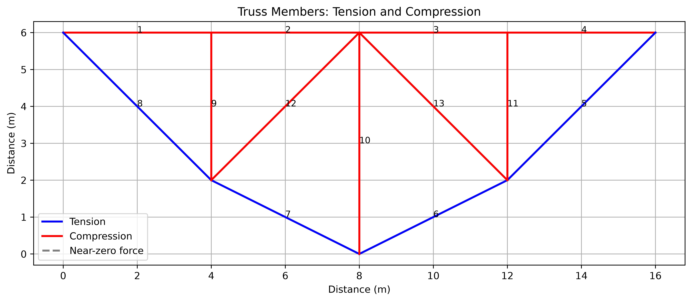

# OpenSeesPy Learning Lab

A hands-on learning project for structural analysis and visualization using Python and OpenSeesPy.

This repository documents the step-by-step implementation of structural analysis models, beginning with a two-dimensional (2D) truss and progressing toward more advanced structural engineering applications.

## Project 01: Linear Static Analysis of a 2D Truss

### Overview

This project implements a linear static analysis of a 2D truss structure using OpenSeesPy. The model consists of 8 nodes and 13 truss members and is subjected to three concentrated vertical loads.

The analysis results include nodal displacements, member axial forces, and visualizations of the deformed configuration and tension/compression behavior.

### Model Properties

| Parameter | Value |
|---|---:|
| Spatial dimensions | 2D |
| Number of nodes | 8 |
| Number of truss members | 13 |
| Young's modulus, \(E\) | 200 GPa |
| Cross-sectional area, \(A\) | 0.005 m² |
| Analysis type | Linear static |
| Load at Node 2 | 10 kN downward |
| Load at Node 3 | 30 kN downward |
| Load at Node 4 | 5 kN downward |

### Tools and Technologies

- Python
- OpenSeesPy
- NumPy
- Matplotlib

## Project Structure

```text
OpenSeesPy-Learning-Lab/
├── 01-truss-visualization/
│   ├── truss_geometry.py
│   ├── truss_model.py
│   ├── figures/
│   │   ├── truss_geometry.png
│   │   ├── deflection plot.png
│   │   └── truss_tension_compression.png
│   └── results/
│       ├── nodal_displacements.csv
│       └── member_axial_forces.csv
├── requirements.txt
├── .gitignore
└── README.md
```

## Results and Visualizations

### 1. Original Truss Geometry

The initial geometry shows the node coordinates and connectivity of the 13 truss members.


### 2. Deformed Shape

The deformed configuration is plotted together with the original structure. The displacements are amplified by a factor of 500 for visualization; therefore, the displayed deformation is not to scale.


### 3. Tension and Compression Members

Blue lines represent members in tension, while red lines represent members in compression. Member numbers are included for identification.



## Numerical Results

### Nodal Displacements

The following table summarizes the calculated horizontal and vertical nodal displacements.

| Node | Horizontal, \(U_x\) (m) | Vertical, \(U_y\) (m) |
|---:|---:|---:|
| 1 | 0.00000 | 0.00000 |
| 2 | −0.00010 | −0.00063 |
| 3 | −0.00019 | −0.00073 |
| 4 | −0.00028 | −0.00057 |
| 5 | −0.00036 | 0.00000 |
| 6 | −0.00005 | −0.00055 |
| 7 | −0.00018 | −0.00058 |
| 8 | −0.00032 | −0.00059 |

The maximum downward displacement is approximately **0.73 mm at Node 3**.

Full results: [`nodal_displacements.csv`](01-truss-visualization/results/nodal_displacements.csv)

### Member Axial Forces

Positive axial forces indicate tension, and negative axial forces indicate compression under the sign convention used in this model.

| Member | Connectivity | Axial Force (kN) | Behavior |
|---:|:---:|---:|---|
| 1 | 1–2 | −23.75 | Compression |
| 2 | 2–3 | −23.75 | Compression |
| 3 | 3–4 | −21.25 | Compression |
| 4 | 4–5 | −21.25 | Compression |
| 5 | 5–6 | +30.05 | Tension |
| 6 | 6–7 | +27.95 | Tension |
| 7 | 7–8 | +27.95 | Tension |
| 8 | 1–8 | +33.59 | Tension |
| 9 | 2–8 | −10.00 | Compression |
| 10 | 3–7 | −25.00 | Compression |
| 11 | 4–6 | −5.00 | Compression |
| 12 | 3–8 | −1.77 | Compression |
| 13 | 3–6 | −5.30 | Compression |

Full results: [`member_axial_forces.csv`](01-truss-visualization/results/member_axial_forces.csv)

### Key Findings

- **4 members are in tension** and **9 members are in compression**.
- The maximum tensile force is approximately 33.59 kN in Member 8.
- The maximum compression force magnitude is 25.00 kN in Member 10.
- The maximum downward nodal displacement is approximately 0.73 mm at Node 3.

## Installation

Clone the repository:

```bash
git clone https://github.com/alamgirarafat15/OpenSeesPy-Learning-Lab.git
cd OpenSeesPy-Learning-Lab
```

Install the required packages:

```bash
python -m pip install -r requirements.txt
```

OpenSeesPy may require a compatible Python version and platform-specific dependencies.

## Running the Project

Run the geometry visualization:

```bash
python 01-truss-visualization/truss_geometry.py
```

Run the structural model and analysis:

```bash
python 01-truss-visualization/truss_model.py
```

The model script performs the analysis, extracts numerical results, generates visualizations, and saves the results when the corresponding export code is included.

## Learning Objectives

- Define nodes and truss elements in OpenSeesPy.
- Assign elastic material properties and cross-sectional areas.
- Apply support constraints and nodal loads.
- Configure and perform linear static analysis.
- Extract nodal displacements and member axial forces.
- Visualize deformed shapes and member force behavior.
- Export numerical results to CSV for documentation and further analysis.

## Validation

The calculated nodal displacements and member axial forces agree with the corresponding numerical results reported in the EngineeringSkills introductory OpenSeesPy tutorial.

This comparison provides a basic verification of the implementation against the tutorial example; it is not an independent validation of the software or a structural design certification.

## Learning Reference

EngineeringSkills — [Introduction to OpenSees and OpenSeesPy](https://www.engineeringskills.com/posts/introduction-to-opensees-and-openseespy)

## Future Development

Planned learning stages include:

- 2D portal frame analysis
- Beam-column elements and section properties
- Structural response visualization using `opsvis`
- Modal and eigenvalue analysis
- Nonlinear static analysis
- Nonlinear time-history analysis using earthquake ground motions
- Seismic response prediction and machine learning applications

## Disclaimer

This repository is intended for educational and research-learning purposes. The models and results should not be used directly for real-world structural design without appropriate independent verification.

## Author

**Mohammad Arafat Alamgir**

Civil Engineering | Structural Analysis | OpenSeesPy | Computational Mechanics
